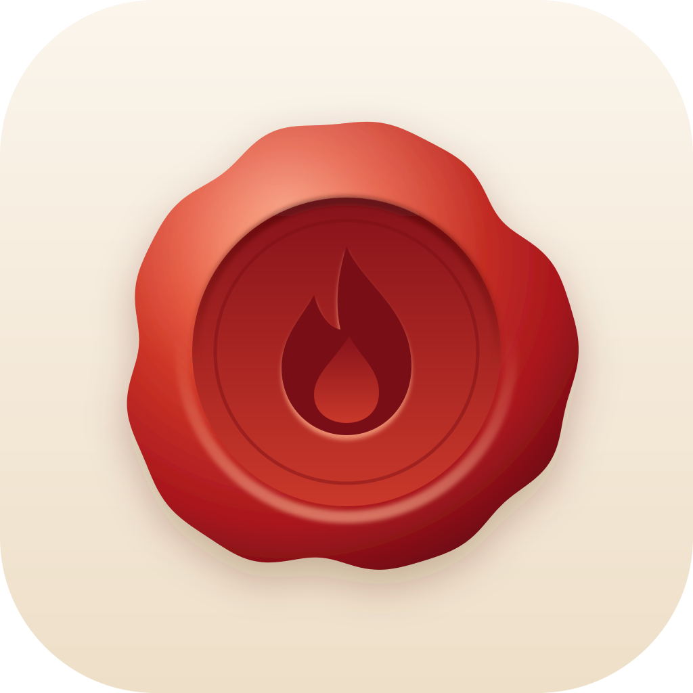

# Signet

Sign, customise and install iOS apps right on your iPhone, with your own certificate.

## Install

Signet needs to be signed before it can sign anything, so the first install uses another tool. It needs iOS 17 or
later.

- **From a sideloading app.** Add this source in AltStore, SideStore, Feather, Ksign or ESign, then install Signet:

  ```
  https://and101.github.io/Signet/source.json
  ```

- **From a computer.** Download `Signet.ipa` from the [latest release](https://github.com/and101/Signet/releases/latest)
  and install it with [Sideloadly](https://sideloadly.io) or [AltStore](https://altstore.io). With a free Apple ID
  the app expires after 7 days. With a paid developer account it lasts a year.
- **With your own certificate.** Sign `Signet.ipa` with your `.p12` and provisioning profile in any signer.

### Updates

From 1.1, new versions appear in **Library → Updates** because Signet's own source is added by default. Tap
**Update**, sign it with the bundle ID Signet is installed with, and install it over the current Signet. Signet closes
while it installs, and later updates reuse the same settings. You can also track `and101/Signet` in **Sources → + →
Track GitHub Repo**, which fills in Signet's bundle ID for you.

Switching to a certificate with a different bundle ID makes iOS treat Signet as a new app. Back up first in
**Settings → Back Up…** and restore in the new copy.

## Features

- **Certificates.** Import `.p12` and provisioning profile pairs. See expiry, devices and entitlements, and check
  for revocation. Passwords stay in the keychain. Send a certificate to LiveContainer.
- **Library.** Import IPAs from Files, other apps, a URL, a source or a GitHub release. Updates from your sources
  appear at the top. Select several apps to delete them.
- **Signing.** Change the name (in every language), bundle ID, version, minimum iOS and icon, including the app's
  own alternate icons. Remove device limits, URL schemes, the Watch app or individual extensions and frameworks.
  Turn on file sharing, ProMotion or Game Mode, force light or dark mode, and choose Liquid Glass or the classic
  look. Merge the app's entitlements with your profile's, or use your own entitlements file.
- **Updates.** Signing a new version reuses the last version's settings, tweaks and icon, so it installs over it.
- **Rename rules.** Give apps a bundle ID or name automatically whenever they're signed.
- **PPQ protection.** For profiles that have Apple check apps at launch, Signet adds a short suffix to bundle IDs
  so they never match an App Store app.
- **Tweaks.** Inject `.dylib`, `.deb` and zipped `.framework` files, into extensions too. Jailbreak paths are
  fixed and ElleKit is added when a tweak needs it.
- **Install.** Install over the air from the phone, or directly through a pairing file (beta). Signet keeps running
  in the background and shows iOS's install progress. You can also export the IPA, signed or unsigned.
- **Sources.** Browse AltStore sources, with news, featured apps and screenshots. Signet's own source is
  added by default, so its updates appear in the Library.
- **GitHub releases.** Track a repo to see new IPAs, download them automatically, and set a bundle ID and
  certificate for its apps.
- **Backup.** Save certificates, sources, repos and settings to one file. Certificate passwords are encrypted with
  a backup password.
- **Links.** `signet://source?url=…` adds a source and `signet://install?url=…` downloads an IPA. Signet asks
  first.

Only sign apps you have the right to use, with certificates you own.

## How installs work

iOS only installs apps over the air from trusted HTTPS, and not from `127.0.0.1`. Signet serves the app from a
server inside itself and links to it as `local.backloop.dev`, a public name that points back to the phone.

For HTTPS, Signet creates its own certificate authority and deletes its private key straight after use. Install it
once in **Settings → Install Certificate**. Without the key, it can't vouch for any other site.

If installs fail:

- Ad blockers or DNS filters may block `local.backloop.dev`. Allow it.
- Signet keeps running in the background while an app installs. If installs stop when you leave Signet, check
  **Settings → Keep Running During Installs** is on.
- If an app won't open, trust the developer in **Settings → General → VPN & Device Management**. Development and
  ad hoc profiles also need your device in the profile.

## Direct install (beta)

Direct install sends apps straight to the iPhone's installer, the way a computer does. It's faster, doesn't need the
install certificate and lets Signet update itself. Set it up in **Settings → Install Method → Direct**:

1. **Pairing file.** On a computer, install [iloader](https://github.com/nab138/iloader/releases/latest), connect the
   iPhone with a cable and choose **Manage Pairing File**. Export `PairingFile_RemoteRP.plist` and import it in
   Signet. Make a new one after an iOS update or reset.
2. **LocalDevVPN.** Install [LocalDevVPN](https://apps.apple.com/app/id6755608044) and keep it connected while
   installing. Wi-Fi must be on.
3. **Test Connection** in the same screen.

If direct install can't connect, Signet offers the install server instead. When Signet updates itself, it closes so
iOS can replace it. Open it again a few seconds later.

## Building

Requires Xcode 26 and [XcodeGen](https://github.com/yonaskolb/XcodeGen).

```sh
./scripts/fetch-idevice.sh   # once, downloads the idevice library for direct install
xcodegen generate
open Signet.xcodeproj
```

Set your team under **Signing & Capabilities** and run on your device.

**Tests.** Create the test fixtures once, then run the suite:

```sh
./scripts/make-test-fixtures.sh
xcodebuild test -project Signet.xcodeproj -scheme Signet -destination 'platform=iOS Simulator,name=iPhone 18 Pro'
```

**Translations.** All text is in `Signet/Resources/Localizable.xcstrings`. After changing text in the code, run
`./scripts/sync-strings.sh` to update it. Building in Xcode does the same. Add languages in Xcode's string catalogue
editor.

**Releases.** Set the version and build in `project.yml`, write `docs/release-notes/<version>.md` and run
`./scripts/release.sh`. It builds an unsigned `build/Signet.ipa` and updates the source in `docs/`. Commit, push, then
create the release:

```sh
gh release create v<version> build/Signet.ipa --title "Signet <version>" --notes-file docs/release-notes/<version>.md
```

## Licence

Signet is released under the [MIT License](LICENSE). It includes
[zsign](https://github.com/khcrysalis/Zsign-Package) (MIT, with patches listed in `Vendor/Zsign/PATCHES.md`),
[ElleKit](https://github.com/tealbathingsuit/ellekit) (BSD-3-Clause) and [idevice](https://github.com/jkcoxson/idevice)
(MIT). It also uses OpenSSL, SwiftNIO, swift-certificates, ZIPFoundation and SWCompression under their own licences.

**Settings → Acknowledgements** lists every component, including idevice's Rust dependencies.
`scripts/make-acknowledgements.py` regenerates the list.
